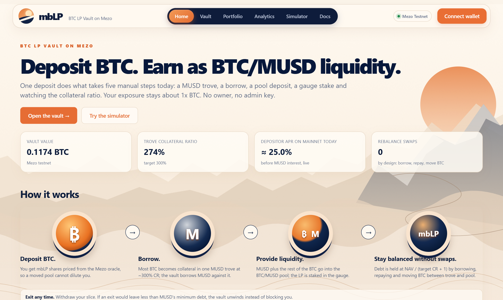
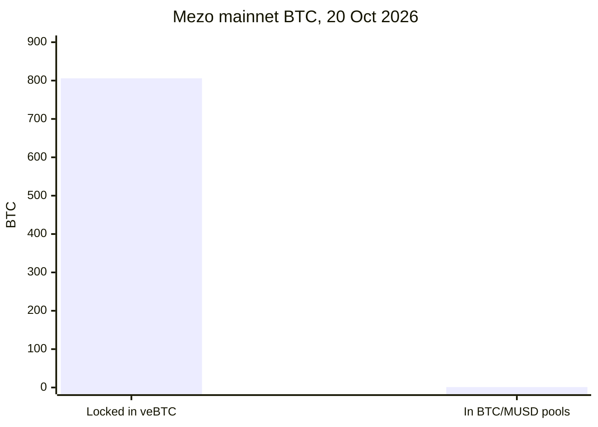
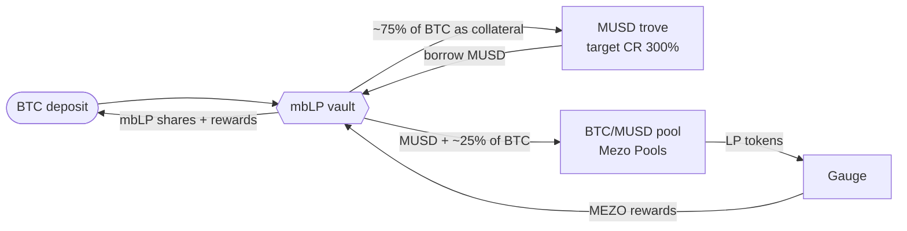
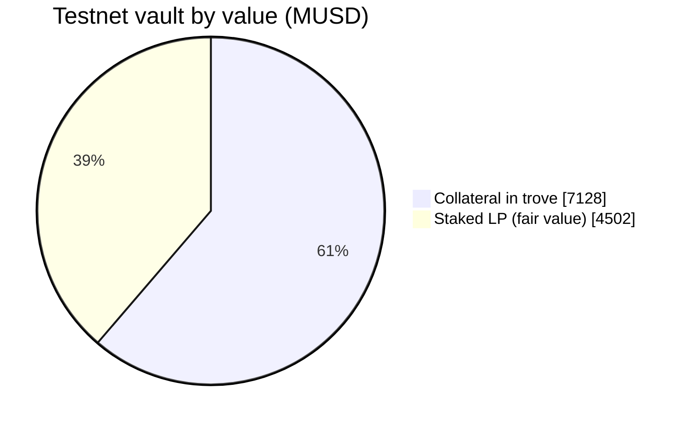
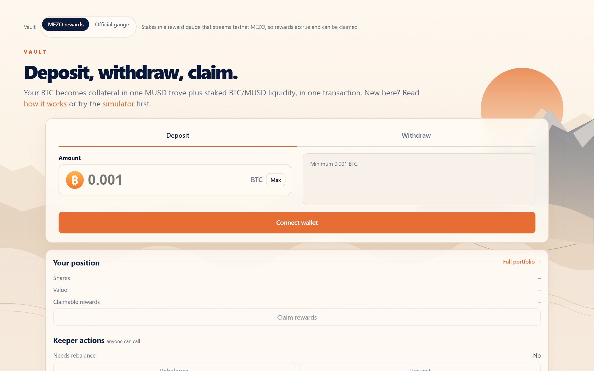
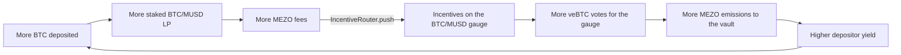
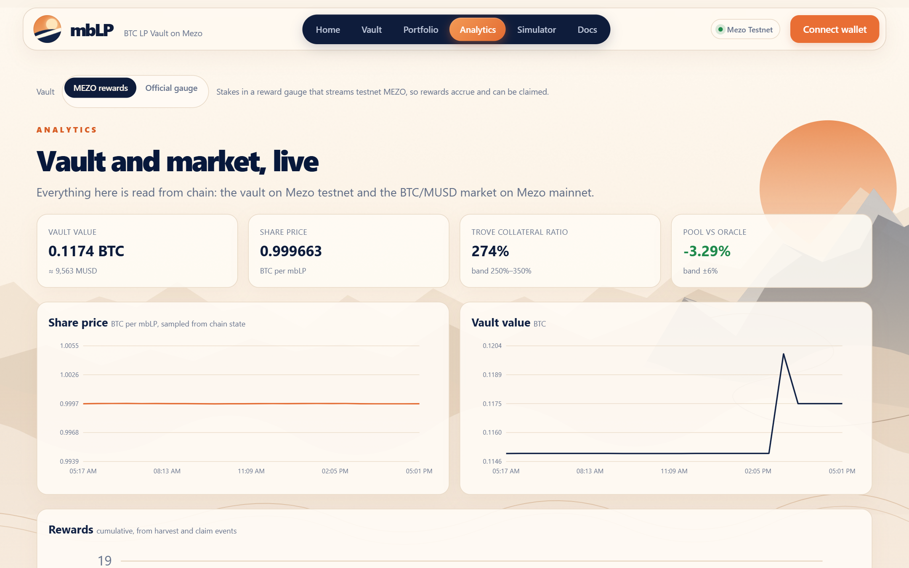
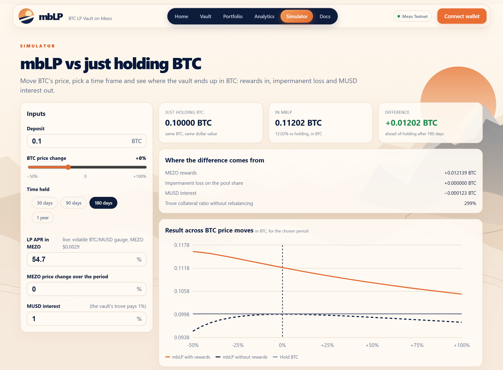

# mbLP — BTC-only liquidity vault on Mezo

[](https://github.com/GuTS805/Akindo/actions/workflows/ci.yml)


**Deposit BTC, hold one token, earn as BTC/MUSD liquidity on Mezo.** In a single transaction the
vault opens a MUSD trove against your BTC, borrows MUSD, pairs it with BTC in Mezo's BTC/MUSD pool
and stakes the LP in the pool's gauge. Your exposure stays about 1x BTC, and nobody has to manage
a collateral ratio.

<p align="center">
  <a href="https://mblp.vercel.app"></a>
</p>

<p align="center">
  <a href="https://mblp.vercel.app"><b>Live app</b></a> ·
  <a href="https://mblp.vercel.app/docs/">Docs</a> ·
  <a href="https://explorer.test.mezo.org/address/0xc41192A186C0ee2F593D611b0D0C00501B5Eea03?tab=contract">Verified contract</a> ·
  <a href="contracts/">Contracts &amp; tests</a> ·
  <a href="docs/evidence.md">Evidence (every tx)</a> ·
  <a href="docs/roadmap.md">Roadmap</a>
</p>

---

## The problem

Mezo has plenty of BTC, but almost none of it is liquid. On mainnet (20 Oct 2026) about
**806 BTC is locked in veBTC**, while all BTC/MUSD pools together hold about **1.07 BTC**. Buying
BTC with MUSD costs 1–2% against the oracle at $1k–$10k sizes.



The gauges already pay for liquidity (the volatile BTC/MUSD gauge streams ~42k MEZO a day), but
providing it takes a trove, a borrow, a pool deposit, a gauge stake and constant attention to the
collateral ratio. mbLP collapses that into one deposit, and every deposit adds MUSD debt and
BTC/MUSD depth to Mezo.

## How it works



| Step | What the vault does |
| --- | --- |
| **Deposit** | Mints shares priced from the Mezo oracle, so a moved pool cannot dilute holders. Deploys the BTC in the same transaction when the pool is inside the oracle band. |
| **Borrow** | Keeps one MUSD trove at a 300% target collateral ratio (band 250–350%), far from MUSD's 110% liquidation line. |
| **Provide** | Adds the MUSD plus matching BTC to the volatile BTC/MUSD pool and stakes the LP. |
| **Rebalance** | Holds debt at `NAV / (targetCR + 1)` by borrowing, repaying and moving BTC between trove and pool. It **never swaps**. |
| **Harvest** | Pulls gauge rewards, takes a 10% fee and credits the rest per share. Claims stay exact across share transfers. |
| **Exit** | Pays a pro-rata slice of every position. A MUSD shortfall is settled inside the vault at the oracle price + 0.5%, so exits do not move the pool. An exit that would break MUSD's 1,800 minimum debt unwinds the position instead of blocking anyone. |

Because the MUSD in the pool roughly matches the MUSD debt, the position is BTC plus yield, not
leverage. By value it sits at about 61% trove collateral and 39% staked LP (live testnet vault):



<p align="center">
  
</p>

The vault page does all of it in one place: deposit, withdraw 25–100% of your shares with the exact
payout simulated before you sign, claim rewards, and the permissionless keeper actions.

## Built on Mezo

| Mezo component | How mbLP uses it |
| --- | --- |
| **BTC precompile** | Native BTC is the only asset a user deposits and receives |
| **MUSD** — BorrowerOperations, TroveManager, HintHelpers, SortedTroves | Opens, adjusts and closes the vault's trove; sorted-list hints on every change |
| **PriceFeed** | Prices shares, bands every pool action, values LP at the fair price `2·√(k·price)` |
| **Mezo Pools** — Router, volatile BTC/MUSD pool, Gauge | Liquidity, LP staking and MEZO rewards |
| **Redemptions and liquidations** | Surplus collateral is reclaimed automatically; after a liquidation the vault keeps its LP and rebuilds the trove |
| **Mezo Earn** (vote-escrow) | The vault's fee can flow through `IncentiveRouter` into the BTC/MUSD gauge's incentive contract, buying veBTC votes for its own pool (below) |
| **Mezo Passport** | Bitcoin wallets (Unisat, OKX, Xverse) connect through Passport's connectors and act through a Mezo smart account, next to any EVM wallet |
| **Mainnet data** | Gauge emissions, pool depth, MEZO price, MUSD supply and veBTC are read live in the app |

### The fee flywheel

Mezo Earn splits MEZO emissions between gauges by veBTC votes, and protocols attract those votes
by posting incentives on a gauge. mbLP's fee can do exactly that. With an
[`IncentiveRouter`](contracts/src/IncentiveRouter.sol) as the fee recipient, anyone can call
`push()` to post part of the collected MEZO on the BTC/MUSD gauge's `BribeVotingReward` and send
the rest to the treasury:



On a Mezo mainnet fork, one day of fees from a 0.2 BTC deposit posted **184 MEZO** on the live
gauge's incentive contract, booked to the current epoch
([`MainnetFork.t.sol`](contracts/test/MainnetFork.t.sol)). The router has no owner; its split
and destinations are fixed at deployment.

**No owner, no admin key, no upgrades.** The fee and every parameter are fixed at deployment, and
`rebalance` and `harvest` can be called by anyone.

## Try it on testnet

1. Get testnet BTC from the [Mezo faucet](https://faucet.test.mezo.org).
2. Open **[mblp.vercel.app](https://mblp.vercel.app)** and connect an EVM wallet (the app adds Mezo Testnet for you) or a Bitcoin wallet through Mezo Passport. A Bitcoin wallet acts through a Mezo smart account, shown in the header; fund that address from the faucet.
3. **Deposit** from 0.001 BTC. It goes into the trove and pool in the same transaction.
4. Watch **claimable MEZO** grow on the Vault and Portfolio pages, then **Claim**.
5. **Withdraw** any share of your position.

The testnet runs three deployments, selectable at the top of the Vault, Portfolio and Analytics
pages:

| Vault | Gauge | Why |
| --- | --- | --- |
| **v2** (default) — [`0x652e…9102`](https://explorer.test.mezo.org/address/0x652e31Ba2658CC27ff0E36431cA008De7D439102) | [`RewardGauge`](https://explorer.test.mezo.org/address/0x204ef88B33e5d35De7b52F8c1FFa58cf89d4f45b) | The current contract. Fixes from the [review pass](contracts/SECURITY.md#review-findings-october-2026): a deposit pays its own MUSD borrowing fee, a 2 BTC deposit cap, and a failed deployment leaves the deposit idle instead of reverting it. Its fee recipient is the [`IncentiveRouter`](https://explorer.test.mezo.org/address/0x924b8a4585B659D78041569fE0074719116126F2). |
| **v1** — [`0xc411…Ea03`](https://explorer.test.mezo.org/address/0xc41192A186C0ee2F593D611b0D0C00501B5Eea03) | Same [`RewardGauge`](https://explorer.test.mezo.org/address/0x204ef88B33e5d35De7b52F8c1FFa58cf89d4f45b), streaming testnet MEZO | The first release, where the live deposit → claim → withdraw in the evidence ran. Mezo's official testnet gauge has never received emissions and only the Voter can fund it; this gauge has the same interface and anyone can fund it, so harvest and claim pay out for real. |
| **Official gauge** — [`0x1879…B2d4`](https://explorer.test.mezo.org/address/0x187958091532733eF2f8703F8029Cd72aA85B2d4) | Mezo's testnet BTC/MUSD gauge | The setup the vault would use on mainnet. |

<p align="center">
  
</p>

The **Analytics** page reads everything from chain: share price and vault value sampled from
historical state, what the vault holds, the keeper and reward-stream status, the live Mezo mainnet
BTC/MUSD market, and a filterable log of every vault event. **Portfolio** shows your position, its
result against simply holding the BTC, and your transaction history.

## Yield

The app reads the mainnet gauge live. On 20 Oct 2026 the volatile BTC/MUSD gauge paid ~42k MEZO a
day on ~82k MUSD of staked LP, about a **55% LP APR** in MEZO. Roughly half of the vault's value is
LP, so a depositor would earn about **24% a year before MUSD interest** (1%), falling as more
liquidity joins the gauge.

<p align="center">
  
</p>

The **Simulator** compares mbLP with holding BTC over any period and BTC price move, splitting the
result into MEZO rewards, impermanent loss on the pool share and MUSD interest. Without rewards
the vault tracks plain BTC closely around today's price; the rewards are what put it ahead.

## Security and testing

Every claim here is backed by a transaction or a reproducible test in
[`docs/evidence.md`](docs/evidence.md), including a fresh wallet's live deposit → claim →
withdraw on the rewards vault.

| Suite | Tests | Covers |
| --- | --- | --- |
| Unit and fuzz | 27 | Share pricing, deposit and exit paths, rebalancing in every direction, slippage, donations, reward accounting |
| Recovery | 5 | Liquidation fallback and trove reopening, redemption surplus, reward leaks on share transfers, donation attacks |
| Reward gauge | 9 | Streaming, top-ups, stake splits, vault harvest → claim end to end |
| v2 deposits | 5 | A newcomer pays its own MUSD borrowing fee (holders are not diluted), the deposit cap, a failed deployment leaves the deposit idle instead of reverting it |
| Incentive router | 7 | Fee split between gauge incentives and treasury, permissionless push, config guards, refused incentives fall back to the treasury |
| Manipulation | 7 | Deposit → push the pool off the oracle → withdraw → push it back, with the attacker's own capital. Never profitable (512-run fuzz, 1–2,000 BTC, 2–80% skews, at mainnet's real 0.3% pool fee) |
| Edge cases | 18 | Every config guard, stale oracle, slippage limits, empty and idle vaults, approved transfers, surplus claims, and the last exit after a 15% fall (waits for arbitrage rather than sell below the band, then pays in full) |
| Invariant | 65,536 random actions | Deposits, withdrawals, transfers, reward streams, oracle moves, pool manipulation, liquidations and redemptions. Checks that shares and rewards add up, the trove obeys MUSD's rules, no LP is left unstaked and **every holder can exit** |
| Testnet fork | 1 | Full deposit → partial → full withdraw against the deployed testnet MUSD and Mezo Pools contracts (0.9997 BTC back per BTC) |
| **Mainnet fork** | 1 | The same cycle against **mainnet** MUSD, the BTC/MUSD pool and the live MEZO gauge: 0.2 BTC earned **3,309 MEZO in one day** and returned 0.19995 BTC; the fee flywheel posts 184 MEZO on the gauge's real incentive contract |

- Oracle-band guard on adding liquidity and rebalancing, oracle-based minimum outputs on every swap; exits skip the band so holders can always leave, and the manipulation suite shows that cannot be exploited
- LP valued at the manipulation-resistant fair price; dead shares against first-depositor inflation; reentrancy guards
- The tests caught five real bugs before deployment (liquidation recovery, redemption surplus, reward leak on transfer, exits blocked by minimum debt, exits walking a thin pool); each fix is its own `fix:` commit
- Coverage of `src/`: **97% of lines, 100% of functions**, 76% of branches (`forge coverage`)
- [CI](https://github.com/GuTS805/Akindo/actions/workflows/ci.yml) runs every suite, both fork tests and the app build on each push
- Slither: 32 results, each reviewed in [`contracts/SECURITY.md`](contracts/SECURITY.md); none needed a code change
- A second review pass (security, TypeScript, failure paths) and what each finding led to: [`contracts/SECURITY.md#review-findings-october-2026`](contracts/SECURITY.md#review-findings-october-2026)
- Source verified on the Mezo explorer. **Not audited.**

## Known limits

- **MEZO rewards** have little on-chain liquidity today. The vault pays them out and never sells them.
- **Impermanent loss** applies to the ~25% of value in the pool.
- **Stale oracle:** MUSD reads the oracle on every trove change, so deposits and exits wait while it is stale.
- **MUSD recovery mode** (system CR under 150%) blocks closing troves and restricts collateral withdrawals; exits that need either wait for the system to recover.
- **The last exit** buys the LP's MUSD gap on the DEX and waits rather than sell BTC below the oracle band. Not binding on testnet; it can be on a thin mainnet pool.

## Roadmap

Full plan, including the path to a Mezo Market listing and the economics: [`docs/roadmap.md`](docs/roadmap.md).

- **Wave 2:** a range-managed strategy for the concentrated BTC/MUSD pool (the larger gauge share), the incentive router as the mainnet vault's fee recipient, and a real-wallet Passport run
- **Mainnet:** freeze, add a deposit cap, audit, then deploy on Mezo's own gauge. It stays off mainnet until then on purpose: with no owner there is no pause, which is only safe for audited code. No team seed is needed: deposits wait as withdrawable idle BTC until together they can carry MUSD's minimum debt, then anyone's `rebalance()` opens the trove. The configuration is in [`MezoMainnet`](contracts/script/Addresses.sol) and exercised by the mainnet fork test

## Development

```shell
# Contracts
cd contracts
forge install foundry-rs/forge-std@v1.17.0 OpenZeppelin/openzeppelin-contracts@v5.4.0 --no-git
forge test                                                        # unit, fuzz, recovery, gauge, invariant
MEZO_TESTNET_RPC=https://rpc.test.mezo.org forge test --mc "^ForkTest"  # live testnet contracts
MEZO_MAINNET_RPC=https://mezo.drpc.org forge test --mc MainnetForkTest   # live mainnet contracts

# App
cd app
npm ci
npm run dev
```

| Path | Contents |
| --- | --- |
| [`contracts/src/`](contracts/src/) | `BtcLpVault.sol`, `IncentiveRouter.sol`, `RewardGauge.sol`, Mezo interfaces |
| [`contracts/test/`](contracts/test/) | Unit, recovery, gauge, invariant and fork suites with mocks of MUSD and Mezo Pools |
| [`contracts/script/`](contracts/script/) | Testnet deploy, reward funding and keeper scripts |
| [`contracts/deployments/`](contracts/deployments/testnet.json) | Deployed addresses and transactions |
| [`app/`](app/) | Vite + TypeScript + viem frontend: Home, Vault, Portfolio, Analytics, Simulator, Docs |
| [`.github/workflows/`](.github/workflows/) | CI, GitHub Pages deploy and a keeper scheduled every 30 minutes (GitHub runs it every few hours in practice) that calls `rebalance` / `harvest` |

Deployment details, addresses and the full parameter set are in [`contracts/README.md`](contracts/README.md).

## License

MIT, see [LICENSE](LICENSE).
