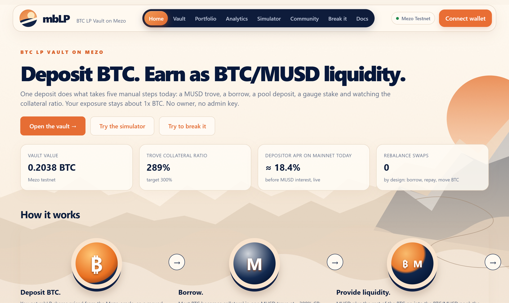
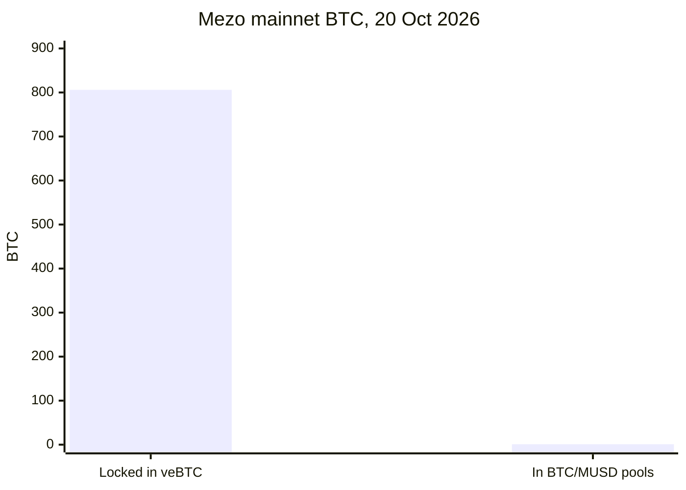
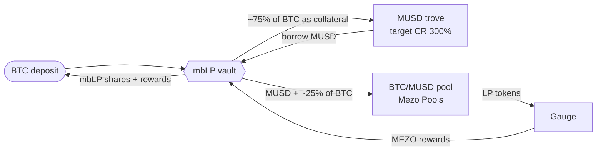
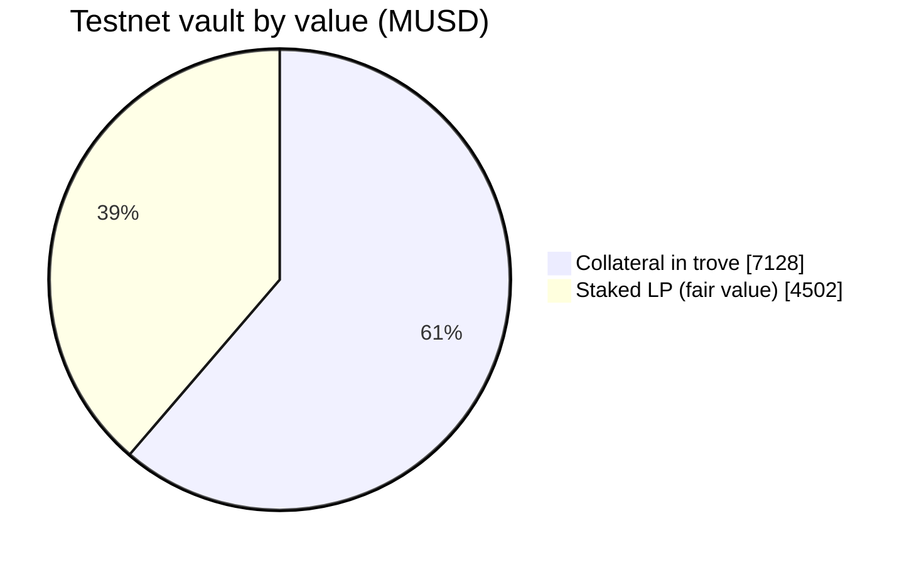
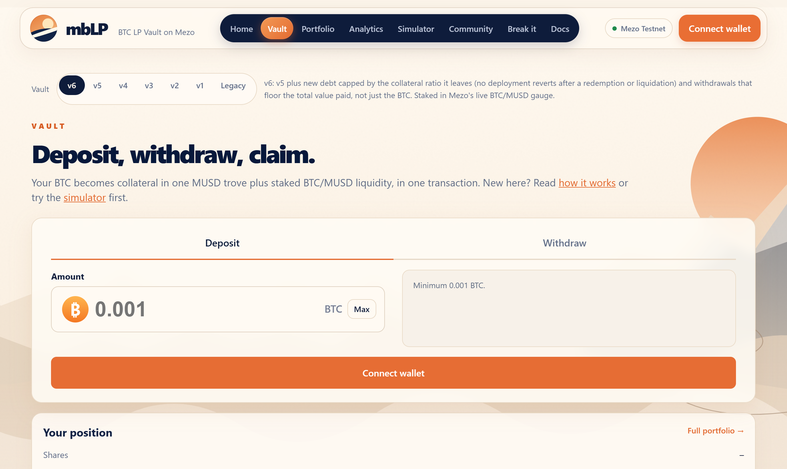
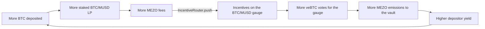
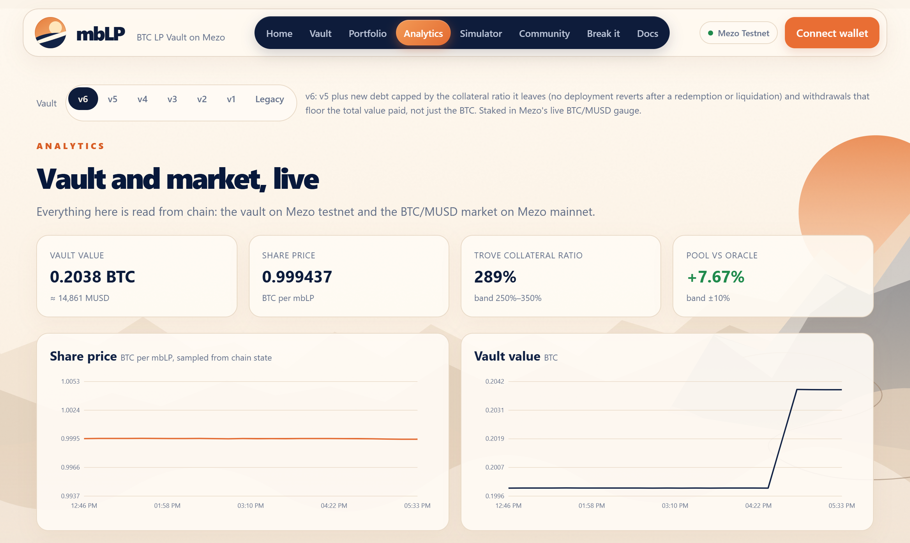
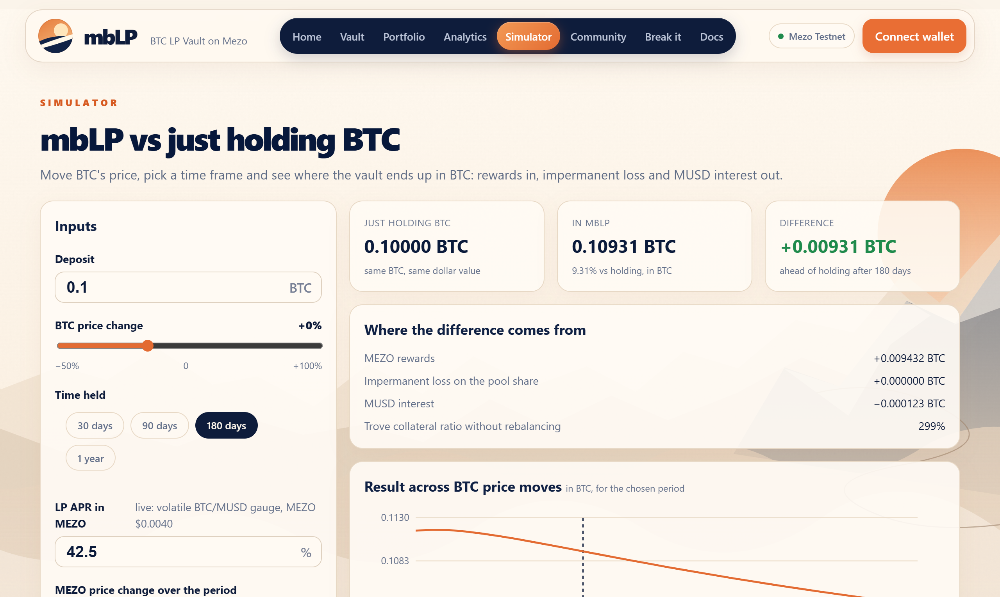

# mbLP — BTC-only liquidity vault on Mezo

[](https://github.com/GuTS805/Akindo/actions/workflows/ci.yml)


**Deposit BTC, hold one token, earn as BTC/MUSD liquidity on Mezo.** In a single transaction the
vault opens a MUSD trove against your BTC, borrows MUSD, pairs it with BTC in Mezo's BTC/MUSD pool
and stakes the LP in the pool's gauge. Your exposure stays about 1x BTC, and nobody has to manage
a collateral ratio.

<p align="center">
  <a href="https://mblp.neocities.org"></a>
</p>

<p align="center">
  <a href="https://mblp.neocities.org"><b>Live app</b></a> ·
  <a href="https://mblp.neocities.org/docs/">Docs</a> ·
  <a href="https://youtu.be/ICVxyTolYig">Wave 1 video</a> ·
  <a href="docs/mbLP-wave2-video.srt">Wave 2 video script</a> ·
  <a href="docs/mbLP-wave2-deck.pdf">Wave 2 deck</a> ·
  <a href="docs/mbLP-deck.pdf">Wave 1 deck</a> ·
  <a href="https://mblp.neocities.org/break/">Try to break it</a> ·
  <a href="https://mblp.neocities.org/community/">Community</a> ·
  <a href="https://explorer.test.mezo.org/address/0x1309FdcFB8394dC63b350409F44b311D7B0dE0C0?tab=contract">Verified contract</a> ·
  <a href="contracts/">Contracts &amp; tests</a> ·
  <a href="docs/evidence.md">Evidence (every tx)</a> ·
  <a href="docs/roadmap.md">Roadmap</a>
</p>

---

## The problem

Mezo has plenty of BTC, but almost none of it is liquid. On mainnet (20 Oct 2026) about
**806 BTC is locked in veBTC**, while all BTC/MUSD pools together hold about **1.07 BTC**. Buying
BTC with MUSD costs 1–2% against the oracle at $1k–$10k sizes. On 12 Nov 2026 it was still 804 BTC in veBTC
against 0.90 BTC in the two BTC/MUSD pools.



The gauges already pay for liquidity (the volatile BTC/MUSD gauge streamed ~42k MEZO a day in October, ~15k on 12 Nov), but
providing it takes a trove, a borrow, a pool deposit, a gauge stake and constant attention to the
collateral ratio. mbLP collapses that into one deposit, and every deposit adds MUSD debt and
BTC/MUSD depth to Mezo.

## How it works



| Step | What the vault does |
| --- | --- |
| **Deposit** | Mints shares priced from the Mezo oracle, so a moved pool cannot dilute holders. Deploys the BTC in the same transaction when the pool is inside the oracle band. |
| **Borrow** | Keeps one MUSD trove at a 300% target collateral ratio (band 250–350%), far from MUSD's 110% liquidation line. |
| **Provide** | Adds the MUSD plus matching BTC to the volatile BTC/MUSD pool and stakes the LP. |
| **Rebalance** | Holds debt at `NAV / (targetCR + 1)` by borrowing, repaying and moving BTC between trove and pool. It **never swaps**. |
| **Harvest** | Pulls gauge rewards, takes a 10% fee and credits the rest per share. Claims stay exact across share transfers. |
| **Exit** | Pays a pro-rata slice of every position. A MUSD shortfall is settled inside the vault at the oracle price + 0.5%, so exits do not move the pool. An exit that would break MUSD's 1,800 minimum debt unwinds the position instead of blocking anyone. |

Because the MUSD in the pool roughly matches the MUSD debt, the position is BTC plus yield, not
leverage. By value it sits at about 61% trove collateral and 39% staked LP (live testnet vault):



<p align="center">
  
</p>

The vault page does all of it in one place: deposit, withdraw 25–100% of your shares with the exact
payout simulated before you sign, claim rewards, and the permissionless keeper actions.

## Built on Mezo

| Mezo component | How mbLP uses it |
| --- | --- |
| **BTC precompile** | Native BTC is the only asset a user deposits and receives |
| **MUSD** — BorrowerOperations, TroveManager, HintHelpers, SortedTroves | Opens, adjusts and closes the vault's trove; sorted-list hints on every change |
| **PriceFeed** | Prices shares, bands every pool action, values LP at the fair price `2·√(k·price)` |
| **Mezo Pools** — Router, volatile BTC/MUSD pool, Gauge | Liquidity, LP staking and MEZO rewards |
| **Redemptions and liquidations** | Surplus collateral is reclaimed automatically; after a liquidation the vault keeps its LP and rebuilds the trove |
| **Mezo Earn** (vote-escrow) | The vault's fee flows through `IncentiveRouter` into the BTC/MUSD gauge's incentive contract, buying veBTC votes for its own pool; live on testnet (below) |
| **Mezo Passport** | Bitcoin wallets (Unisat, OKX, Xverse) connect through Passport's connectors and act through a Mezo smart account, next to any EVM wallet |
| **Mainnet data** | Gauge emissions, pool depth, MEZO price, MUSD supply and veBTC are read live in the app |

### The fee flywheel

Mezo Earn splits MEZO emissions between gauges by veBTC votes, and protocols attract those votes
by posting incentives on a gauge. mbLP's fee can do exactly that. With an
[`IncentiveRouter`](contracts/src/IncentiveRouter.sol) as the fee recipient, anyone can call
`push()` to post part of the collected MEZO on the BTC/MUSD gauge's `BribeVotingReward` and send
the rest to the treasury:



It runs live on testnet: the v3 vault's router posted its first fees on the live BTC/MUSD gauge's
incentive contract in [`0xa7724a6c…cb26`](https://explorer.test.mezo.org/tx/0xa7724a6c5cda61f678b71d477412c39f16a59e210ba448544ed7f89ea48dcb26)
(0.0961 MEZO as an incentive, 0.0961 MEZO to the treasury). On a Mezo mainnet fork, one day of
fees from a 0.2 BTC deposit posted **89 MEZO** on the mainnet gauge's incentive contract (184 MEZO in October,
when emissions were higher), booked to the current epoch ([`MainnetFork.t.sol`](contracts/test/MainnetFork.t.sol)). The router has no
owner; its split and destinations are fixed at deployment.

**No owner, no admin key, no upgrades.** The fee and every parameter are fixed at deployment, and
`rebalance` and `harvest` can be called by anyone.

## Try it on testnet

1. Get testnet BTC from the [Mezo faucet](https://faucet.test.mezo.org).
2. Open **[mblp.neocities.org](https://mblp.neocities.org)** and connect an EVM wallet (the app adds Mezo Testnet for you) or a Bitcoin wallet through Mezo Passport. A Bitcoin wallet acts through a Mezo smart account, shown in the header; fund that address from the faucet.
   MetaMask's site scanner marks whole free-hosting domains as unsafe (vercel.app, github.io and, since November, surge.sh), so the app moved to Neocities, which it does not flag (checked 12 Nov). The old addresses (mblp.surge.sh, mblp.vercel.app, guts805.github.io/Akindo) now redirect every page to the same page on Neocities. Mezo's explorer is another route: the [Community page](https://mblp.neocities.org/community/#explorer-route) has the five steps.
3. **Deposit** from 0.001 BTC. It goes into the trove and pool in the same transaction.
4. Watch **claimable MEZO** grow on the Vault and Portfolio pages, then **Claim**.
5. **Withdraw** any share of your position.

The testnet runs seven deployments, selectable at the top of the Vault, Portfolio and Analytics
pages:

| Vault | Gauge | Why |
| --- | --- | --- |
| **v6** (default) — [`0x1309…E0C0`](https://explorer.test.mezo.org/address/0x1309FdcFB8394dC63b350409F44b311D7B0dE0C0?tab=contract) | Mezo's live BTC/MUSD [gauge](https://explorer.test.mezo.org/address/0x72D88B0795373437E86792DEd8362D66dC43Cd2c) | v5 plus new debt capped by the collateral ratio it leaves (no deployment revert after a redemption or liquidation) and `withdrawMinValue`, which floors the total value a withdrawal pays, not only its BTC. Same 10% testnet band and fee recipient. |
| **v5** — [`0xB1CF…914D`](https://explorer.test.mezo.org/address/0xB1CF6f9F21bEE3421e0C99a435741dCdB1Ba914D?tab=contract) | Mezo's live BTC/MUSD [gauge](https://explorer.test.mezo.org/address/0x72D88B0795373437E86792DEd8362D66dC43Cd2c) | Wave 2 review fixes: deployment steps of a tenth of the pool, so pushing the pool to the band edge around a deposit or rebalance loses money; a rebalance that can cut debt while the pool trails a falling oracle. A 10% oracle band on testnet, where the pool usually drifts 4-8% (mainnet: 2%). Same fee recipient as v3. |
| **v4** — [`0x897F…8D9f`](https://explorer.test.mezo.org/address/0x897F89aBf67dACC3634E169a3896bfCaFd388D9f?tab=contract) | Mezo's live BTC/MUSD [gauge](https://explorer.test.mezo.org/address/0x72D88B0795373437E86792DEd8362D66dC43Cd2c) | Wave 2: refinances its trove to grow past MUSD's borrowing cap, keeps exits open in Recovery Mode, and counts debt redistributed from a liquidation once. Same fee recipient as v3. |
| **v3** — [`0x7553…BFEC`](https://explorer.test.mezo.org/address/0x75532765bfBa32E8DC796292937F9c571a2dBFEC) | Mezo's live BTC/MUSD [gauge](https://explorer.test.mezo.org/address/0x72D88B0795373437E86792DEd8362D66dC43Cd2c), paid MEZO by Mezo's Voter each epoch | The v2 contract, earning real MEZO emissions exactly as it would on mainnet. Its fee recipient, an [`IncentiveRouter`](https://explorer.test.mezo.org/address/0x28bAf157D84aa72Bf7Ac3800c8243F1557cf2605), posts fees on that gauge's incentive contract, where MEZO is whitelisted. |
| **v2** — [`0x652e…9102`](https://explorer.test.mezo.org/address/0x652e31Ba2658CC27ff0E36431cA008De7D439102) | [`RewardGauge`](https://explorer.test.mezo.org/address/0x204ef88B33e5d35De7b52F8c1FFa58cf89d4f45b) | The current contract. Fixes from the [review pass](contracts/SECURITY.md#review-findings-october-2026): a deposit pays its own MUSD borrowing fee, a 2 BTC deposit cap, and a failed deployment leaves the deposit idle instead of reverting it. Its fee recipient is the [`IncentiveRouter`](https://explorer.test.mezo.org/address/0x924b8a4585B659D78041569fE0074719116126F2). |
| **v1** — [`0xc411…Ea03`](https://explorer.test.mezo.org/address/0xc41192A186C0ee2F593D611b0D0C00501B5Eea03) | Same [`RewardGauge`](https://explorer.test.mezo.org/address/0x204ef88B33e5d35De7b52F8c1FFa58cf89d4f45b), streaming testnet MEZO | The first release, where the live deposit → claim → withdraw in the evidence ran. The RewardGauge has the same interface as Mezo's gauges and anyone can fund it. |
| **Legacy** — [`0x1879…B2d4`](https://explorer.test.mezo.org/address/0x187958091532733eF2f8703F8029Cd72aA85B2d4) | The BTC/MUSD gauge on Mezo's older testnet Voter | That Voter's emissions stopped on 13 Nov 2025, so this vault earns nothing; v3 replaced it. |

<p align="center">
  
</p>

The **Analytics** page reads everything from chain: share price and vault value sampled from
historical state, what the vault holds, the keeper and reward-stream status, the live Mezo mainnet
BTC/MUSD market, and a filterable log of every vault event. **Portfolio** shows your position, its
result against simply holding the BTC, and your transaction history.

## Yield

The app reads the mainnet gauge live. On 20 Oct 2026 the volatile BTC/MUSD gauge paid ~42k MEZO a
day on ~82k MUSD of staked LP, about a **55% LP APR** in MEZO. Roughly half of the vault's value is
LP, so a depositor would earn about **24% a year before MUSD interest** (1%), falling as more
liquidity joins the gauge. On 12 Nov the gauge paid ~15k MEZO a day and the app showed a 42.5% LP APR,
about 19% for a depositor: emissions vary week to week with veBTC votes.

<p align="center">
  
</p>

The **Simulator** compares mbLP with holding BTC over any period and BTC price move, splitting the
result into MEZO rewards, impermanent loss on the pool share and MUSD interest. Without rewards
the vault tracks plain BTC closely around today's price; the rewards are what put it ahead.

## Security and testing

Every claim here is backed by a transaction or a reproducible test in
[`docs/evidence.md`](docs/evidence.md), including a fresh wallet's live deposit → claim →
withdraw on the rewards vault.

| Suite | Tests | Covers |
| --- | --- | --- |
| Unit and fuzz | 27 | Share pricing, deposit and exit paths, rebalancing in every direction, slippage, donations, reward accounting |
| Recovery | 6 | Liquidation fallback and trove reopening, redemption surplus, reward leaks on share transfers, donation attacks, debt redistributed from a liquidation counted once |
| Borrowing cap | 3 | MUSD's borrowing cap: a small deposit does not refinance, a 20x deposit refinances and deploys in full over keeper steps, a deposit in Recovery Mode waits idle and deploys after |
| Recovery Mode | 4 | Exits pay the NAV share in BTC and repay debt, wait once LP runs out, refuse a skewed pool; a deposit made then stays withdrawable |
| Sandwich | 2 | Pushing the pool to the band edge around a rebalance, a deposit or a withdrawal never profits (2%, 6% and 10% bands, both directions); an off-band delever after a fall is never worth more than the plain arbitrage |
| Crash exit | 1 | Oracle -45% with the pool left behind: `rebalance()` cuts the debt and the trove is back above `minCR` |
| Value floor | 5 | `withdrawMinValue` floors BTC plus MUSD at the oracle price, also when a pushed pool shifts the mix |
| Guards | 9 | First deposit above the dead shares, a deposit that would round to zero shares, an emptied vault, a value floor without an oracle, a Recovery Mode exit under MUSD's minimum debt, a small vault held at the minimum debt after a fall, a pool too thin for the minimum debt, an empty pool |
| Mainnet token order | 37 | The unit, borrowing-cap, Recovery Mode and sandwich suites rerun with BTC as the pool's token0, as on mainnet (on testnet MUSD sorts first) |
| Reward gauge | 9 | Streaming, top-ups, stake splits, vault harvest → claim end to end |
| v2 deposits | 5 | A newcomer pays its own MUSD borrowing fee (holders are not diluted), the deposit cap, a failed deployment leaves the deposit idle instead of reverting it |
| Incentive router | 7 | Fee split between gauge incentives and treasury, permissionless push, config guards, refused incentives fall back to the treasury |
| Manipulation | 7 | Deposit → push the pool off the oracle → withdraw → push it back, with the attacker's own capital. Never profitable (512-run fuzz, 1–2,000 BTC, 2–80% skews, at mainnet's real 0.3% pool fee) |
| Edge cases | 18 | Every config guard, stale oracle, slippage limits, empty and idle vaults, approved transfers, surplus claims, and the last exit after a 15% fall (waits for arbitrage rather than sell below the band, then pays in full) |
| Invariant | 65,536 random actions | Deposits, withdrawals, transfers, reward streams, oracle moves, pool manipulation, liquidations and redemptions. Checks that shares and rewards add up, the trove obeys MUSD's rules, no LP is left unstaked and **every holder can exit**. A replay of its one CI failure (a test-harness artifact, see [SECURITY.md](contracts/SECURITY.md#review-findings-october-2026)) runs with it |
| Testnet fork | 5 | Against the deployed testnet contracts: full deposit → partial → full withdraw (0.9997 BTC back per BTC), a 13x deposit past MUSD's borrowing cap (cap 7,590 → 106,843 MUSD, 1.9995 of 2 BTC back), an exit in Recovery Mode (0.3999 of 0.4 BTC back), MEZO earned from Mezo's live testnet gauge (691 MEZO in a day on 1 BTC), and fees booked as incentives on its incentive contract |
| **Mainnet fork** | 3 | The same cycle against **mainnet** MUSD, the BTC/MUSD pool and the live MEZO gauge: 0.2 BTC earned **1,595 MEZO in one day** at 12 Nov emissions (3,309 in October) and returned 0.19995 BTC; a 13x deposit past the borrowing cap (cap 10,076 → 109,371 MUSD, 1.9995 of 2 BTC back); the fee flywheel posts 89 MEZO a day on the gauge's real incentive contract |

142 tests in 21 suites (the invariant suite counts as one), plus eight fork tests.

- Oracle-band guard on adding liquidity and rebalancing, oracle-based minimum outputs on every swap; exits skip the band so holders can always leave, and the manipulation suite shows that cannot be exploited
- LP valued at the manipulation-resistant fair price; dead shares against first-depositor inflation; reentrancy guards
- The tests caught five real bugs before deployment (liquidation recovery, redemption surplus, reward leak on transfer, exits blocked by minimum debt, exits walking a thin pool); each fix is its own `fix:` commit
- Coverage of `src/`: **97% of lines, 95% of statements, 100% of functions, 81% of branches** (`forge coverage --fuzz-seed 1`, November 2026; the invariant suite's random seed moves these by a few points)
- [CI](https://github.com/GuTS805/Akindo/actions/workflows/ci.yml) runs every suite, both fork tests and the app build on each push
- Slither: 48 results on the current code, each reviewed in [`contracts/SECURITY.md`](contracts/SECURITY.md); none needed a code change
- Two review passes and what each finding led to: [October](contracts/SECURITY.md#review-findings-october-2026) and [November (Wave 2)](contracts/SECURITY.md#review-findings-november-2026-wave-2), where attacking the vault found five more gaps, each fixed with a test that failed first
- [Try to break it](https://mblp.neocities.org/break/): twelve attacks sent live to the deployed vault from a stranger's address, with the revert reasons shown
- Source verified on the Mezo explorer. **Not audited.** Reviewers welcome: [`contracts/REVIEW.md`](contracts/REVIEW.md) has the scope, the eight properties we believe hold and how to check each

## Known limits

- **MEZO rewards** have little on-chain liquidity today. The vault pays them out and never sells them.
- **Impermanent loss** applies to the ~25% of value in the pool.
- **Stale oracle:** MUSD reads the oracle on every trove change, so deposits and exits wait while it is stale.
- **MUSD Recovery Mode** (system CR under 150%) blocks collateral withdrawals, closing troves and new borrowing. v4 to v6 keep exits open: a leaver is paid their NAV share from idle assets and LP, with debt repaid from the LP's MUSD. Beyond the idle assets about a quarter of the NAV can leave this way, larger exits wait for Recovery Mode to end, and deposits wait idle (still withdrawable).
- **The last exit** buys the LP's MUSD gap on the DEX and waits rather than sell BTC below the oracle band. Not binding on testnet; it can be on a thin mainnet pool.
- **Idle deposits in some states:** a deposit waits as idle, withdrawable BTC when the pool is outside the oracle band, in Recovery Mode, before the vault holds enough to open a trove (~0.11 BTC at today's price), when it would leave idle BTC under 1% of the vault (small deposits wait until together they pass that, so each does not pay MUSD's borrowing fee alone; their shares earn from the start), and when a tenth of the pool's MUSD is under MUSD's 1,800 minimum debt (a pool under ~18,000 MUSD; mainnet's holds ~35,000), so no trove can open. Before v6 a deployment step could also fail its collateral-ratio check after a redemption, a liquidation or exits settled inside the vault; v6 caps new debt by the ratio it leaves ([details](contracts/SECURITY.md#review-findings-october-2026)). A large deposit is deployed over several keeper steps, each adding at most a tenth of the pool.
- **Testnet pool drift:** the testnet pool sits 4-8% from the oracle with no arbitrage (8.1% on 12 Nov, 13.9% on 13 Nov), so earlier testnet vaults (6% band) can stay idle; v5 and v6 use a 10% band there, and past 10% deposits wait idle and a rebalance may only cut debt (when the trove is under `minCR`) until the pool comes back; outside Recovery Mode exits do not check the band. Mainnet uses 2%.

## Roadmap

Full plan, including the path to a Mezo Market listing and the economics: [`docs/roadmap.md`](docs/roadmap.md).

- **Wave 2:** a range-managed strategy for the concentrated BTC/MUSD pool (the larger gauge share), the incentive router as the mainnet vault's fee recipient
- **Mainnet:** freeze, add a deposit cap, audit, then deploy on Mezo's own gauge. It stays off mainnet until then on purpose: with no owner there is no pause, which is only safe for audited code. No team seed is needed: deposits wait as withdrawable idle BTC until together they can carry MUSD's minimum debt, then anyone's `rebalance()` opens the trove. The configuration is in [`MezoMainnet`](contracts/script/Addresses.sol) and exercised by the mainnet fork test

## Development

```shell
# Contracts
cd contracts
forge install foundry-rs/forge-std@v1.17.0 OpenZeppelin/openzeppelin-contracts@v5.4.0 --no-git
forge test                                                        # unit, fuzz, recovery, gauge, invariant
MEZO_TESTNET_RPC=https://rpc.test.mezo.org forge test --mc "^ForkTest"  # live testnet contracts
MEZO_MAINNET_RPC=https://mezo.drpc.org forge test --mc MainnetForkTest   # live mainnet contracts

# App
cd app
npm ci
npm run dev
```

| Path | Contents |
| --- | --- |
| [`contracts/src/`](contracts/src/) | `BtcLpVault.sol`, `IncentiveRouter.sol`, `RewardGauge.sol`, Mezo interfaces |
| [`contracts/test/`](contracts/test/) | Unit, recovery, gauge, invariant and fork suites with mocks of MUSD and Mezo Pools |
| [`contracts/script/`](contracts/script/) | Testnet deploy, reward funding and keeper scripts |
| [`contracts/deployments/`](contracts/deployments/testnet.json) | Deployed addresses and transactions |
| [`app/`](app/) | Vite + TypeScript + viem frontend: Home, Vault, Portfolio, Analytics, Simulator, Docs |
| [`.github/workflows/`](.github/workflows/) | CI, GitHub Pages deploy and a keeper scheduled every 30 minutes (GitHub runs it every few hours in practice) that calls `rebalance` / `harvest` |

Deployment details, addresses and the full parameter set are in [`contracts/README.md`](contracts/README.md).

## License

MIT, see [LICENSE](LICENSE).
